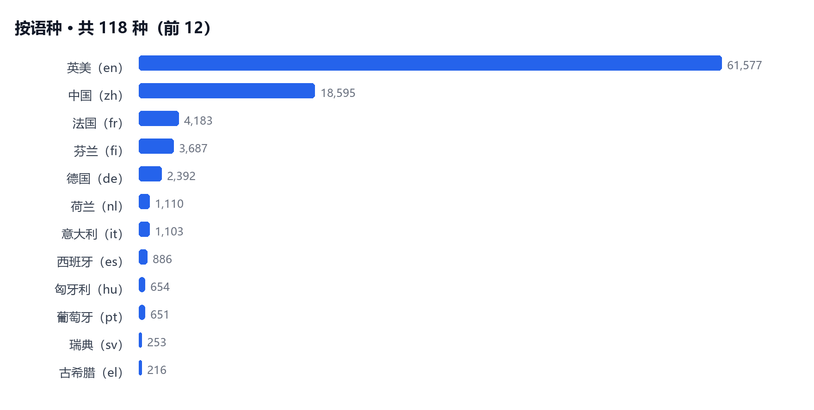
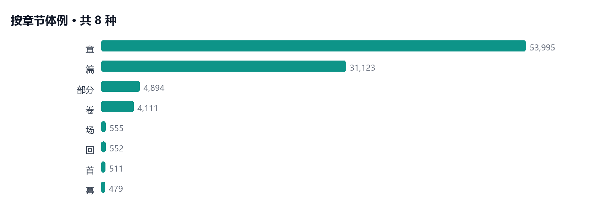

# Biquge · Vapaassa käytössä olevien kirjojen luettelo

[English](README.md) ｜ [简体中文](README.zh.md) ｜ [Français](README.fr.md) ｜ [Deutsch](README.de.md) ｜ **Suomi** ｜ [日本語](README.ja.md)

**96 220 vapaassa käytössä olevaa kirjaa, 118 kieltä, 2 808 551 lukua** — avoin tietoaineisto, joka sisältää vain bibliografiset metatiedot, ei kokotekstiä. Jokaisella kirjalla on oma Markdown-sivu: nimi, tekijä, dynastia, kieli, genre, lukujen ja merkkien määrä sekä lähdekirjasto — ja linkki lukusivulle.

[Lue verkossa](https://www.bqgmz.top/) ｜ [Koko luettelo (CSV)](catalog/books.csv) ｜ [Kenttien kuvaus](DATA.md) ｜ [Lähteet ja lisenssit](LICENSE.md) ｜ [Selaa kielen mukaan](list/lang/) ｜ [Selaa lähteen mukaan](list/lib/)



## Pika-aloitus 30 sekunnissa

Tietovarastossa on 96 000 tiedostoa — **kloonausta ei tarvita**, hae CSV suoraan:

```bash
curl -L -o books.csv https://gitee.com/zhanyao668/bqgmz-catalog/raw/master/catalog/books.csv
# GitHub-peili: https://raw.githubusercontent.com/zhanyao/bqgmz-catalog/master/catalog/books.csv
```

```python
import pandas as pd

df = pd.read_csv("books.csv")          # 96 220 riviä × 11 saraketta
df.nlargest(5, "chars")[["title", "author", "chapters", "chars"]]
df[df.lang == "fi"].nlargest(5, "chapters")[["title", "chapters"]]
```

```bash
# JSONL virtaavaan käsittelyyn
curl -sL https://gitee.com/zhanyao668/bqgmz-catalog/raw/master/catalog/books.jsonl \
  | jq -r 'select(.lang=="fi") | [.title,.author,.chapters] | @tsv' | head
```

## Miltä tietue näyttää

| id | title | author | dynasty | lang | unit | chapters | chars | libs |
|---|---|---|---|---|---|---|---|---|
| cc0bdf92e204 | 红楼梦 (Punaisen kamarin unelma) | 曹雪芹 | 清 | zh | 回 | 120 | 729,481 | daizhige;scripta;wenshuoge |
| 910354ce8b29 | 三国演义 (Kolmen valtakunnan tarina) | 罗贯中 | 明 | zh | 回 | 120 | 487,893 | daizhige;scripta;wenshuoge |
| 0a1d530e267f | 水浒传 (Rannan asukkaat) | 施耐庵 | 明 | zh | 回 | 120 | 777,108 | daizhige;scripta;wenshuoge |
| 1cb46e3a4782 | War and Peace | Tolstoy, Leo | — | en | 章 | 288 | 2,628,447 | gutenberg_full |
| 04abfdfbd8fe | The Adventures of Sherlock Holmes | Doyle, Arthur Conan | — | en | 章 | 12 | 454,708 | gutenberg_full |

Kenttämääritelmät: [DATA.md](DATA.md).

## Avainluvut

| Kohta | Arvo |
|---|---|
| Teoksia | 96 220 |
| Lukuja | 2 808 551 |
| Merkkejä | ~24,57 miljardia |
| Kielet / maat / genret | 118 / 33 / 8 |
| Lähteet (teokset voivat kuulua useaan) | Project Gutenberg 78 045 · Daizhige 13 754 · Wenshuoge 12 450 · scripta-sinica 9 581 · chinese-poetry 41 |



> Genre päätellään kunkin lähteen omista lukumerkinnöistä. v5-putki käsittelee osan kirjoista yhtenä lukuna: **17 374 teoksella on täsmälleen 1 luku** (esim. *Gujin Tushu Jicheng*, *Baopuzi*) — tämä on tarkoituksellista, tietoja ei puutu.

## Tietovaraston rakenne

```
README.md                 englanti (oletus); lisäksi README.zh / fr / de / fi / ja
b/<xx>/<id>/README.md     yksi sivu per kirja, xx = workId:n kaksi ensimmäistä hex-merkkiä (256 osaa)
list/lang/<code>/         hakemisto kielen mukaan (→ maa/alue)
list/style/<slug>/        hakemisto lukutyypin mukaan
list/lib/<source>/        hakemisto lähdekirjaston mukaan
catalog/books.csv         koko luettelo (UTF-8, otsikkorivi)
catalog/books.jsonl       samat tiedot, yksi JSON-objekti rivillä
DATA.md / LICENSE.md      kenttämääritelmät / lähteet ja lisenssit
```

Polut vastaavat verkkosivustoa: `b/<xx>/<id>/` vastaa osoitetta `https://www.bqgmz.top/b/<id>/`.

## Lähteet ja lisenssit

| Lähde | Lisenssi | Huomautus |
|---|---|---|
| Daizhige (daizhige-org) | Public domain | Korjattu klassisen kiinan korpus (2026-10-11) |
| Project Gutenberg | Public domain (USA) | Lisenssiosa säilytetään |
| chinese-poetry | Public domain | Klassinen kiinalainen runous |
| scripta-sinica | **CC BY-SA 4.0** | Nimeäminen ja samankaltainen jakelu vaaditaan |
| Wenshuoge | Public domain | Klassisen kiinan korpus |

Tämä tietovarasto sisältää **vain bibliografiset metatiedot — ei kokotekstiä**. Aineisto ei ole kollaatio ja sisältää OCR-kohinaa; se sopii hakuun, tilastointiin ja korpuksen rakentamiseen, mutta ei kriittiseksi editioiksi. Katso [LICENSE.md](LICENSE.md).

## Viittaus

```bibtex
@misc{bqgmz_catalog_2026,
  title        = {Biquge · Vapaassa käytössä olevien kirjojen luettelo (96 220 teosta)},
  author       = {{bqgmz}},
  year         = {2026},
  url          = {https://gitee.com/zhanyao668/bqgmz-catalog},
  note         = {Bibliografiset metatiedot; tekstit lähteistä Daizhige, Project Gutenberg, Wenshuoge, scripta-sinica ja chinese-poetry}
}
```
